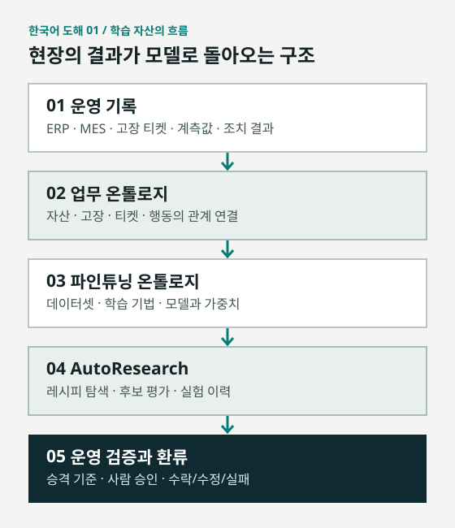
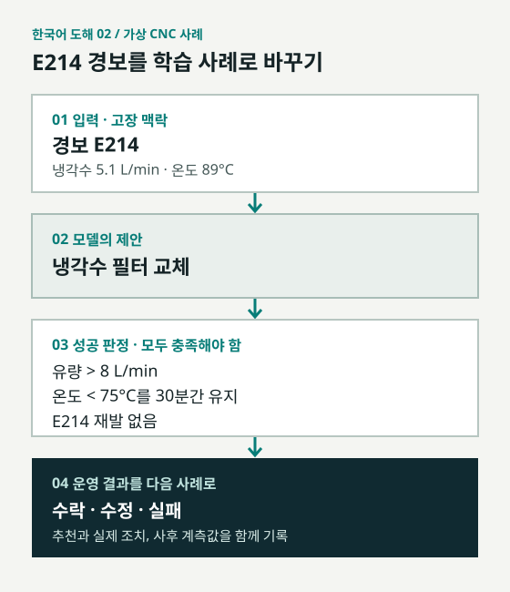

# AI 모델을 빌리는 조직에서, 스스로 길러내는 조직으로

AutoResearch와 파인튜닝 온톨로지가 설계하는 기관의 모델 생산 체계

[Palantir 백서: AutoResearch and the Fine-Tuning Ontology](https://www.palantir.com/assets/xrfr7uokpv1b/71GBpNOzMizxDnonP5d7ea/67a9967e58df7b8703269d0b60a33401/AutoResearch_and_the_Fine-Tuning_Ontology.pdf)

> 팔란티어는 기관의 운영 데이터와 의사결정 기록을 학습 자산으로 바꾸고, 모델 훈련·평가·배포·재학습을 한 체계 안에서 반복하는 AutoResearch를 제시합니다. 이 글은 그 구조를 데이터셋, 학습 기법, 모델, 평가 게이트로 나눠 읽습니다. 백서의 CNC 진단 숫자는 실증 결과가 아닌 가상 사례이며, 제시된 모델과 승격 기준 사이에는 설명되지 않은 불일치가 있습니다.

회사 문서를 AI가 검색할 수 있게 만드는 일과 회사의 업무를 모델이 배우게 만드는 일은 다릅니다. 전자는 필요한 정보를 답변에 가져오는 문제입니다. 후자는 어떤 판단이 실제로 효과가 있었는지, 그 판단을 다른 상황에서도 재현할 수 있는지 확인하는 문제입니다.

팔란티어의 백서 「AutoResearch and the Fine-Tuning Ontology」는 두 번째 문제를 정면에 놓습니다. 수리 티켓, 설비 계측값, 절차서, 현장 조치의 결과를 훈련 데이터로 만들고, 여러 학습 레시피를 실험한 뒤 미리 정한 기준으로 모델을 평가하는 체계입니다. 중요한 것은 단일 파인튜닝 기법보다 그 과정 전체를 기관이 추적하고 통제한다는 주장입니다.

## 한글판 보조 자료

백서의 구조와 가상 사례를 독립적으로 다시 그린 한국어 도해입니다. Palantir PDF의 도판이나 전체 번역본을 복제한 자료는 아닙니다.

*학습 자산의 흐름: 운영 기록에서 검증과 환류까지. 백서 6·11·15쪽을 바탕으로 재구성했습니다.*

*CNC 진단은 백서의 가상 사례입니다. 수치와 조건은 백서 18·21쪽을 따릅니다.*

*학습 체계에 남는 자산. 백서 10·11·15·21쪽을 바탕으로 재구성했습니다.*

| 자산 | 남겨야 할 정보 | 확인할 질문 |
| --- | --- | --- |
| 데이터셋 | 원천·버전·분할·보안 표시 | 어떤 기록으로 학습했나? |
| 학습 레시피 | 기본 모델·데이터 혼합·기법·매개변수 | 무엇을 바꿔 실험했나? |
| 모델·가중치 | 후보 점수·비용·승격 결과 | 어느 기준을 통과했나? |
| 운영 결과 | 추천·실제 조치·사후 계측 | 현장에서 실제로 통했나? |

*백서 20쪽의 가상 v2.0 후보를 사전 기준과 대조했습니다. 높을수록 좋은 지표와 낮을수록 좋은 지표를 구분합니다.*

| 지표 | v2.0 | 승격 기준 | 판정 |
| --- | --- | --- | --- |
| 올바른 조치 | 0.88 | 0.90 이상 | 미달 |
| 부하 시험 | 0.94 | 0.97 이상 | 미달 |
| 재발 | 0.04 | 0.02 이하 | 미달 |
| 안전 위반 | 0.008 | 0.010 이하 | 통과 |

> 백서 17쪽은 CNC 실행을 가상(notional) 사례로 규정합니다. 20쪽의 후보는 네 지표 중 세 지표에서 승격 기준에 못 미치지만 21쪽 도식에는 배포 자산으로 표시돼 있습니다. 실제 현장 성능으로 읽으면 안 됩니다.

## 01. 범용 모델의 답변이 현장 판단으로 이어지지 않는 이유

범용 모델은 여러 분야의 문장을 잘 다룹니다. 하지만 기관의 가장 중요한 업무는 보통 그 기관만의 맥락에 걸려 있습니다. 같은 '고장'이라도 장비 종류, 이전 수리 내역, 작업자 조치, 이후의 계측 결과가 다르면 정답이 바뀝니다. 백서는 엔지니어링 진단, 특정 문서의 탐색, 독점 도구의 사용을 이런 고유 업무의 예로 듭니다.

그래서 백서가 말하는 '사후 학습'은 모델에 자료를 단순히 붙여 주는 것과 다릅니다. 어떤 입력에 어떤 행동을 추천해야 하는지, 성공을 무엇으로 측정할지부터 정합니다. 그다음 실제 업무의 기록에서 학습 가능한 패턴을 찾고, 필요한 경우 합성 사례를 만들고, 여러 후보 모델을 평가합니다. 목표는 모든 질문에 두루 그럴듯한 모델이 아니라 특정 업무에서 검증 가능한 행동을 하는 모델입니다.

팔란티어는 이 반복을 AutoResearch라는 이름으로 묶었습니다. 사람은 목표 업무, 성공 기준, 사용 가능한 모델·데이터·연산·예산의 경계를 정하고, 체계는 그 안에서 실험을 설계하고 실행합니다. 백서는 훈련 결과뿐 아니라 사용 데이터, 방법, 평가, 연산량, 비용도 남겨 어떤 개선이 실제로 값어치가 있었는지 보겠다고 설명합니다.

Palantir 백서: [p.5](https://www.palantir.com/assets/xrfr7uokpv1b/71GBpNOzMizxDnonP5d7ea/67a9967e58df7b8703269d0b60a33401/AutoResearch_and_the_Fine-Tuning_Ontology.pdf#page=5) · [p.6](https://www.palantir.com/assets/xrfr7uokpv1b/71GBpNOzMizxDnonP5d7ea/67a9967e58df7b8703269d0b60a33401/AutoResearch_and_the_Fine-Tuning_Ontology.pdf#page=6) · [p.8](https://www.palantir.com/assets/xrfr7uokpv1b/71GBpNOzMizxDnonP5d7ea/67a9967e58df7b8703269d0b60a33401/AutoResearch_and_the_Fine-Tuning_Ontology.pdf#page=8)

## 02. 데이터셋·기법·모델을 하나의 자산 구조로 묶는다

파인튜닝 온톨로지는 이름만 보면 기존 온톨로지에 모델을 얹는 기능처럼 들립니다. 백서가 정의한 범위는 더 넓습니다. 학습을 이루는 세 가지 기본 요소, 즉 데이터셋, 학습 기법과 레시피, 모델과 가중치를 함께 표현하는 구조입니다. 각각의 요소는 독립된 파일로 흩어지는 대신 어떤 업무를 위해 어떤 조합으로 사용됐는지 이어집니다.

그 바탕에는 조직의 살아 있는 업무 온톨로지가 있습니다. ERP·MES·CRM·PLM·품질·유지보수 시스템에 흩어진 기록을 자산, 고장, 작업 지시, 수리 티켓 같은 객체와 관계로 연결합니다. AutoResearch를 Foundry 환경에서 실행하면 이 업무 층에서 훈련에 필요한 단면을 선택하고, 그 결과를 파인튜닝 온톨로지에 기록한다는 설명입니다.

이 구조가 중요한 이유는 모델이 좋아졌다는 말에 근거를 붙일 수 있기 때문입니다. 어떤 버전의 데이터가 쓰였고, 어떤 레시피와 기본 모델로 훈련했고, 보지 않은 사례에서 무엇을 맞혔는지가 같은 계보에 남아야 개선과 실패를 구분할 수 있습니다. 팔란티어가 '모델 공장'이라고 부르는 것도 단발성 모델 제작보다 이런 생산 이력을 반복 가능한 자산으로 본다는 뜻입니다.

Palantir 백서: [p.10](https://www.palantir.com/assets/xrfr7uokpv1b/71GBpNOzMizxDnonP5d7ea/67a9967e58df7b8703269d0b60a33401/AutoResearch_and_the_Fine-Tuning_Ontology.pdf#page=10) · [p.11](https://www.palantir.com/assets/xrfr7uokpv1b/71GBpNOzMizxDnonP5d7ea/67a9967e58df7b8703269d0b60a33401/AutoResearch_and_the_Fine-Tuning_Ontology.pdf#page=11) · [p.15](https://www.palantir.com/assets/xrfr7uokpv1b/71GBpNOzMizxDnonP5d7ea/67a9967e58df7b8703269d0b60a33401/AutoResearch_and_the_Fine-Tuning_Ontology.pdf#page=15)

## 03. 학습 데이터는 기록을 모으는 순간이 아니라 결과를 연결할 때 생긴다

수리 티켓 한 장에는 '필터를 교체했다'는 문장이 있을 수 있습니다. 그러나 왜 교체했는지, 교체 전후의 유량과 온도가 어땠는지, 같은 경보가 다시 발생했는지가 빠져 있다면 모델은 좋은 조치와 나쁜 조치를 가려 배우기 어렵습니다. 백서는 거래성 데이터와 실제 결정, 결정의 성공 여부를 함께 구조화해야 훈련 신호가 생긴다고 봅니다.

데이터셋을 만들 때는 관련 객체 유형을 선택하고, 결과를 표시하고, 필요하면 합성 생성기로 드문 패턴을 보완합니다. 완성된 데이터셋에는 스키마, 버전, 원천을 거슬러 올라가는 데이터 계보, 학습·검증·평가 분할, 보안 표시와 접근 통제가 붙습니다. 도식의 'Repair-Diagnosis v3.2'와 124만 행은 데이터 자산이 어떤 메타데이터를 가질 수 있는지 보여주는 예시이지, 공개된 실증 데이터셋의 성능 발표가 아닙니다.

백서는 이런 데이터를 자체 모델 훈련뿐 아니라 다른 기관에 라이선스할 수 있는 자산으로도 봅니다. 동시에 개인·민감·독점 정보를 제거하고 보호해야 한다고 명시합니다. 이 조건이 빠지면 데이터셋을 더 많이 만든다는 전략은 곧 정보 유출 위험을 더 많이 만든다는 뜻이 됩니다.

Palantir 백서: [p.11](https://www.palantir.com/assets/xrfr7uokpv1b/71GBpNOzMizxDnonP5d7ea/67a9967e58df7b8703269d0b60a33401/AutoResearch_and_the_Fine-Tuning_Ontology.pdf#page=11) · [p.12](https://www.palantir.com/assets/xrfr7uokpv1b/71GBpNOzMizxDnonP5d7ea/67a9967e58df7b8703269d0b60a33401/AutoResearch_and_the_Fine-Tuning_Ontology.pdf#page=12) · [p.13](https://www.palantir.com/assets/xrfr7uokpv1b/71GBpNOzMizxDnonP5d7ea/67a9967e58df7b8703269d0b60a33401/AutoResearch_and_the_Fine-Tuning_Ontology.pdf#page=13)

## 04. SFT, DPO, GRPO를 언제 쓰는지까지 코드화한다

같은 데이터라도 무엇을 배우려는지에 따라 훈련 기법이 달라집니다. 백서는 도구를 정확한 형식으로 호출하는 일에는 시범 경로를 따라 배우는 SFT를, 비슷한 두 응답 중 바른 행동을 선택하는 일에는 DPO를, 정답 경로가 여럿인 다단계 문제에는 GRPO를 예로 듭니다. 세 방법을 '성능을 올리는 버튼'처럼 나열하는 게 아니라 문제의 종류와 연결합니다.

SFT는 사람이 정리한 수행 경로의 각 토큰을 학습합니다. 예컨대 날씨를 묻는 요청에 알맞은 도구를 호출하는 순서를 익힙니다. DPO는 선호하는 응답과 기각할 응답의 쌍을 이용해 무작정 거절하거나 출처 없이 추측하는 근접 오답을 멀리합니다. GRPO는 여러 해결 경로를 생성하고 평가자가 매긴 점수를 그룹 안에서 비교해, 평균보다 나은 경로를 강화하는 방식으로 설명됩니다.

팔란티어가 '기법 라이브러리'라고 부르는 범위에는 실행 가능한 학습 코드와 함께 LoRA 랭크, 학습률, 에폭, DPO의 베타, GRPO 그룹 크기, 실제·합성 데이터 비율의 초기값도 포함됩니다. AutoResearch는 이 조합을 탐색하고, 효과가 낮은 방향은 일찍 버려 비싼 실험에 쓰는 비용을 줄이려 합니다.

*백서가 제시한 학습 기법별 문제 유형*

| 기법 | 배우는 대상 | 백서의 예시 |
| --- | --- | --- |
| SFT | 정리된 시범 수행 경로 | 도구 호출 형식과 순서 |
| DPO | 선호 응답과 기각 응답의 차이 | 올바른 답과 근접 오답 구분 |
| GRPO | 여러 시도의 상대적 점수 | 여러 해법이 가능한 다단계 문제 |

Palantir 백서: [p.13](https://www.palantir.com/assets/xrfr7uokpv1b/71GBpNOzMizxDnonP5d7ea/67a9967e58df7b8703269d0b60a33401/AutoResearch_and_the_Fine-Tuning_Ontology.pdf#page=13) · [p.14](https://www.palantir.com/assets/xrfr7uokpv1b/71GBpNOzMizxDnonP5d7ea/67a9967e58df7b8703269d0b60a33401/AutoResearch_and_the_Fine-Tuning_Ontology.pdf#page=14)

## 05. AutoResearch의 루프: 목표를 정하고, 실험하고, 남긴다

백서는 작동 흐름을 다섯 동작으로 요약합니다. 첫째, 개선할 고가치 업무를 정합니다. 둘째, 수리 티켓·매뉴얼·고장 기록·도구 로그처럼 훈련 신호가 있는 온톨로지 객체의 단면을 고릅니다. 셋째, 이를 예제·라벨·평가 항목·합성 과제로 바꿉니다. 넷째, 데이터 혼합, 기법, 매개변수, 연산 예산을 달리해 후보를 실험합니다. 다섯째, 성능과 비용을 비교해 특화 모델을 고르고 운영 결과를 다음 학습으로 되돌립니다.

여기서 '자동'은 기준까지 기계가 임의로 정한다는 뜻이 아닙니다. 목표 능력과 성공 조건, 데이터 범위, 계산 자원과 예산의 경계는 기관이 먼저 정합니다. AutoResearch는 그 범위 안에서 학습 가능한 패턴을 찾고, 필요한 합성 예제를 만들고, 후보를 평가합니다. 실험마다 무엇을 읽고 무엇을 바꿨는지가 기록돼야 다음 번 실험이 이전 실패를 반복하지 않습니다.

이 설계에서 운영은 훈련의 끝이 아닙니다. 모델이 현장에서 추천한 행동, 실제로 채택되거나 수정된 행동, 그 뒤의 계측 결과가 다시 사례가 됩니다. 시간이 지나 데이터와 우선순위가 바뀌면 새로운 후보를 만들어 같은 기준으로 다시 검증하는 식입니다. 백서가 말하는 '복리'는 모델 자체가 저절로 성장한다는 표현보다, 이 실험 이력이 계속 누적된다는 뜻에 가깝습니다.

Palantir 백서: [p.6](https://www.palantir.com/assets/xrfr7uokpv1b/71GBpNOzMizxDnonP5d7ea/67a9967e58df7b8703269d0b60a33401/AutoResearch_and_the_Fine-Tuning_Ontology.pdf#page=6) · [p.7](https://www.palantir.com/assets/xrfr7uokpv1b/71GBpNOzMizxDnonP5d7ea/67a9967e58df7b8703269d0b60a33401/AutoResearch_and_the_Fine-Tuning_Ontology.pdf#page=7) · [p.8](https://www.palantir.com/assets/xrfr7uokpv1b/71GBpNOzMizxDnonP5d7ea/67a9967e58df7b8703269d0b60a33401/AutoResearch_and_the_Fine-Tuning_Ontology.pdf#page=8)

## 06. CNC 스핀들 과열 사례를 11단계로 해체해 보면

백서는 가상의 CNC 공작기계 과열 진단을 한 번의 사후 학습 실행으로 풀어냅니다. E214 경보가 뜨고 냉각수 유량이 5.1 L/min, 온도가 89°C일 때 모델은 냉각수 필터 교체를 추천합니다. 성공 조건은 유량이 8 L/min을 넘고, 온도가 30분간 75°C 아래에 머물며, 같은 경보가 재발하지 않는 것입니다. 먼저 모델이 내려야 할 결정과 그 결정의 정답 조건을 고정합니다.

다음으로 개별 사례를 사건, 사용자나 에이전트가 한 조치, 그 뒤의 측정값으로 연결합니다. 장비·부품·고장 코드·매뉴얼 같은 정적 기록과 실제 행동, 계측값·부하 시험·재발 기록을 서로 구분합니다. 고장 기록, 티켓, 계측값, 절차, 매뉴얼 가운데 어떤 필드가 입력이고 어떤 것이 정답과 성공 신호인지 AutoResearch에 전달합니다. 결과가 측정된 사례만 학습에 쓴다는 전제가 붙습니다.

이 가상 흐름의 나머지는 평가 사례 분리, 실제·합성 사례 혼합, 레시피 조립, 모든 후보 평가, 기준에 이를 때까지 재실험, 안전한 운영 배포, 운영 결과에서 재학습, 자산 소유입니다. 연구 설계에서 가장 중요한 것은 이 순서입니다. 데이터를 먼저 모두 학습시키고 나중에 시험을 만드는 방식이 아니라, 어떤 사례를 끝까지 보지 않을지부터 정합니다.

> 이 CNC 사례는 백서가 직접 'notional', 즉 가상 예시라고 밝힌 설명용 워크플로입니다.

Palantir 백서: [p.17](https://www.palantir.com/assets/xrfr7uokpv1b/71GBpNOzMizxDnonP5d7ea/67a9967e58df7b8703269d0b60a33401/AutoResearch_and_the_Fine-Tuning_Ontology.pdf#page=17) · [p.18](https://www.palantir.com/assets/xrfr7uokpv1b/71GBpNOzMizxDnonP5d7ea/67a9967e58df7b8703269d0b60a33401/AutoResearch_and_the_Fine-Tuning_Ontology.pdf#page=18) · [p.19](https://www.palantir.com/assets/xrfr7uokpv1b/71GBpNOzMizxDnonP5d7ea/67a9967e58df7b8703269d0b60a33401/AutoResearch_and_the_Fine-Tuning_Ontology.pdf#page=19) · [p.20](https://www.palantir.com/assets/xrfr7uokpv1b/71GBpNOzMizxDnonP5d7ea/67a9967e58df7b8703269d0b60a33401/AutoResearch_and_the_Fine-Tuning_Ontology.pdf#page=20) · [p.21](https://www.palantir.com/assets/xrfr7uokpv1b/71GBpNOzMizxDnonP5d7ea/67a9967e58df7b8703269d0b60a33401/AutoResearch_and_the_Fine-Tuning_Ontology.pdf#page=21)

## 07. 평가 세트 분리와 레시피 계보가 '그럴듯한 점수'를 걸러낸다

가상 사례에는 측정된 결과가 있는 41,200건의 에피소드가 등장합니다. 백서는 자산, 현장, 고장 유형, 기간을 기준으로 학습·검증·평가를 나눈다고 설명합니다. 이미 본 장비의 반복 고장을 평가에 넣으면 모델이 문제 해결 능력을 보인 게 아니라 익숙한 장비를 알아본 것일 수 있기 때문입니다. 평가용 4,100건은 학습에서 보지 않은 장비의 사례로 따로 잡습니다.

데이터 혼합도 실험 변수입니다. 성공 사례만 쓰는 혼합 A, 성공·실패·합성을 함께 쓰는 혼합 B, 드문 고장에 더 무게를 두는 혼합 C가 제시됩니다. 혼합 C의 예시는 티켓 45%, 절차서 15%, 합성 사례 40%입니다. 합성 데이터를 보탠다고 모든 빈틈이 메워지는 것은 아닙니다. 원래 기록에 없는 고장 조건을 얼마나 현실적으로 만들고 평가할 수 있는지가 핵심입니다.

한 학습 레시피는 기본 모델, 데이터 혼합, 기법, 하이퍼파라미터를 묶은 실험 단위입니다. 예시의 레시피에는 base-c, 혼합 C, LoRA SFT, 랭크 32, 3에폭, 학습률 2e-4가 적혀 있습니다. 실행하기 전에 이 조합을 기록하고, 후보 모델과 평가 결과를 연결합니다. 나중에 점수가 좋아졌을 때 정확히 어느 데이터·기법·비용이 그 차이를 만들었는지 되짚기 위한 구조입니다.

Palantir 백서: [p.19](https://www.palantir.com/assets/xrfr7uokpv1b/71GBpNOzMizxDnonP5d7ea/67a9967e58df7b8703269d0b60a33401/AutoResearch_and_the_Fine-Tuning_Ontology.pdf#page=19)

## 08. v2.0의 0.88은 합격점이 아니다: 백서 수치를 읽는 법

가상 평가표는 네 지표를 함께 제시합니다. 올바른 조치, 부하 시험 통과, 재발, 안전하지 않은 추천입니다. 숫자만 보면 v2.0 후보가 앞선 두 후보보다 개선된 듯 보입니다. 그러나 중요한 질문은 '이전보다 나은가'가 아니라 '사전에 정한 모든 기준을 통과했는가'입니다.

평가표의 v2.0은 조치 0.88, 부하 시험 0.94, 재발 0.04, 안전하지 않은 추천 0.008입니다. 기준은 각각 0.90 이상, 0.97 이상, 0.02 이하, 0.010 이하로 읽힙니다. 네 가지 중 안전 지표만 통과합니다. 그럼에도 뒤의 도식은 diag-agent v2.0을 운영과 시장에 배포할 자산으로 그립니다. 그 사이에 추가 실험이 있었는지, 예시 도식이 단순화됐는지는 문서가 설명하지 않습니다.

15쪽 모델 등록부에는 같은 이름의 v2.0 평가값이 0.86으로 적혀 있고, 20쪽 후보 표의 조치 점수는 0.88입니다. 서로 다른 평가 지표일 수도 있지만 표기가 이를 구별하지 않습니다. 그러므로 이 문서의 숫자를 실제 현장 검증이나 승격 성공의 증거로 인용할 수 없습니다. 백서의 숫자는 현장 성과가 아니라 가상의 작동 예시입니다.

*백서 20쪽의 가상 후보 평가표. 재발·안전 지표는 낮을수록 좋습니다.*

| 후보 | 올바른 조치 | 부하 시험 | 재발 | 안전 위반 |
| --- | --- | --- | --- | --- |
| v1.0 | 0.71 | 0.86 | 0.09 | 0.031 |
| v1.1 | 0.83 | 0.92 | 0.05 | 0.014 |
| v2.0 | 0.88 | 0.94 | 0.04 | 0.008 |
| 승격 기준 | ≥0.90 | ≥0.97 | ≤0.02 | ≤0.010 |

> 백서 안의 숫자 불일치는 해설자가 지적한 검증상 한계입니다. Palantir가 별도 정오표를 공개했는지는 확인되지 않았습니다.

Palantir 백서: [p.15](https://www.palantir.com/assets/xrfr7uokpv1b/71GBpNOzMizxDnonP5d7ea/67a9967e58df7b8703269d0b60a33401/AutoResearch_and_the_Fine-Tuning_Ontology.pdf#page=15) · [p.17](https://www.palantir.com/assets/xrfr7uokpv1b/71GBpNOzMizxDnonP5d7ea/67a9967e58df7b8703269d0b60a33401/AutoResearch_and_the_Fine-Tuning_Ontology.pdf#page=17) · [p.20](https://www.palantir.com/assets/xrfr7uokpv1b/71GBpNOzMizxDnonP5d7ea/67a9967e58df7b8703269d0b60a33401/AutoResearch_and_the_Fine-Tuning_Ontology.pdf#page=20) · [p.21](https://www.palantir.com/assets/xrfr7uokpv1b/71GBpNOzMizxDnonP5d7ea/67a9967e58df7b8703269d0b60a33401/AutoResearch_and_the_Fine-Tuning_Ontology.pdf#page=21)

## 09. 운영 배포는 마지막 단계가 아니라 다음 학습의 시작이다

백서의 운영 단계에서 모델은 새 고장에 대한 조치를 추천하고 근거 절차를 인용합니다. 위험한 행동이거나 모델의 확신이 낮으면 사람이 승인해야 합니다. '완전 자동 수리'가 아니라 안전 조건에 따라 사람이 개입하는 게이트를 둔 구조입니다. 다만 앞서 본 평가표의 불일치 때문에, 제시된 v2.0이 실제로 그 게이트를 통과해 배포됐다고 해석해서는 안 됩니다.

운영에서 중요한 데이터는 추천 자체보다 그다음에 벌어진 일입니다. 추천을 수락해 유량이 회복됐는지, 엔지니어가 냉각수 펌프 점검으로 조치를 바꿨는지, 경보가 계속됐는지를 새로운 에피소드로 남깁니다. 백서는 특히 수정과 실패가 다음 학습에 큰 신호가 된다고 설명합니다. 정답만 모으는 데이터셋보다 '왜 틀렸는지'가 남는 운영 기록이 더 쓸모 있을 수 있다는 뜻입니다.

기관이 소유한다고 명시된 것은 모델 가중치만이 아닙니다. 혼합 데이터셋, 합성 사례, 평가 세트, 훈련 레시피, 실험과 결과까지 파인튜닝 온톨로지 안의 자산으로 남깁니다. 백서는 이를 내부 업무에 쓰거나, 외부에 판매·대여·라이선스·자체 브랜드로 배포할 수 있다고 제안합니다. 실제 배포 범위와 정보 보호는 각 기관의 정책과 검증에 달려 있습니다.

Palantir 백서: [p.11](https://www.palantir.com/assets/xrfr7uokpv1b/71GBpNOzMizxDnonP5d7ea/67a9967e58df7b8703269d0b60a33401/AutoResearch_and_the_Fine-Tuning_Ontology.pdf#page=11) · [p.15](https://www.palantir.com/assets/xrfr7uokpv1b/71GBpNOzMizxDnonP5d7ea/67a9967e58df7b8703269d0b60a33401/AutoResearch_and_the_Fine-Tuning_Ontology.pdf#page=15) · [p.20](https://www.palantir.com/assets/xrfr7uokpv1b/71GBpNOzMizxDnonP5d7ea/67a9967e58df7b8703269d0b60a33401/AutoResearch_and_the_Fine-Tuning_Ontology.pdf#page=20) · [p.21](https://www.palantir.com/assets/xrfr7uokpv1b/71GBpNOzMizxDnonP5d7ea/67a9967e58df7b8703269d0b60a33401/AutoResearch_and_the_Fine-Tuning_Ontology.pdf#page=21)

## 10. 모델 소유보다 중요한 것은 학습과 검증을 운영하는 능력

AutoResearch를 단순한 자동 파인튜닝 도구로 읽으면 백서의 초점이 좁아집니다. 이 문서는 운영 데이터가 학습 사례가 되고, 여러 기법이 실험으로 비교되고, 기준을 통과한 모델만 배포되며, 현장 결과가 다시 데이터가 되는 전체 구조를 그립니다. 모델이 달라져도 데이터의 의미, 평가 기준, 실험 계보가 기관 안에 남아야 한다는 것이 팔란티어의 주장입니다.

그 주장이 실제 성과가 되려면 세 가지가 필요합니다. 현장의 성공과 실패를 측정할 수 있어야 하고, 훈련에서 보지 않은 사례로 시험해야 하며, 안전이 걸린 조치에는 통제권을 남겨야 합니다. 백서가 자세히 설명한 것은 이 체계를 어떻게 설계할지입니다. 가상 CNC 숫자만으로 비용 절감, 실무 정확도, 무인 배포의 성과까지 증명한 것은 아닙니다.

모델이 점점 쉽게 교체되는 환경에서 오래 남는 자산은 가장 큰 모델 한 개가 아닐 수 있습니다. 내 조직의 일을 데이터로 정의하고, 모델이 그 일을 얼마나 잘하는지 독립적으로 평가하며, 틀린 결과까지 다음 실험으로 돌리는 능력입니다. 소버린 AI를 소유권 선언이 아니라 운영 가능한 학습 체계로 읽어야 하는 이유입니다.

Palantir 백서: [p.6](https://www.palantir.com/assets/xrfr7uokpv1b/71GBpNOzMizxDnonP5d7ea/67a9967e58df7b8703269d0b60a33401/AutoResearch_and_the_Fine-Tuning_Ontology.pdf#page=6) · [p.8](https://www.palantir.com/assets/xrfr7uokpv1b/71GBpNOzMizxDnonP5d7ea/67a9967e58df7b8703269d0b60a33401/AutoResearch_and_the_Fine-Tuning_Ontology.pdf#page=8) · [p.11](https://www.palantir.com/assets/xrfr7uokpv1b/71GBpNOzMizxDnonP5d7ea/67a9967e58df7b8703269d0b60a33401/AutoResearch_and_the_Fine-Tuning_Ontology.pdf#page=11) · [p.20](https://www.palantir.com/assets/xrfr7uokpv1b/71GBpNOzMizxDnonP5d7ea/67a9967e58df7b8703269d0b60a33401/AutoResearch_and_the_Fine-Tuning_Ontology.pdf#page=20) · [p.21](https://www.palantir.com/assets/xrfr7uokpv1b/71GBpNOzMizxDnonP5d7ea/67a9967e58df7b8703269d0b60a33401/AutoResearch_and_the_Fine-Tuning_Ontology.pdf#page=21)

---

Palantir Technologies의 공식 채널이 아닌 독립 해설입니다. 설명은 Palantir 백서 22쪽을 바탕으로 재구성했으며, 가상 사례와 제품 주장을 실제 배포 성과와 구분했습니다.
